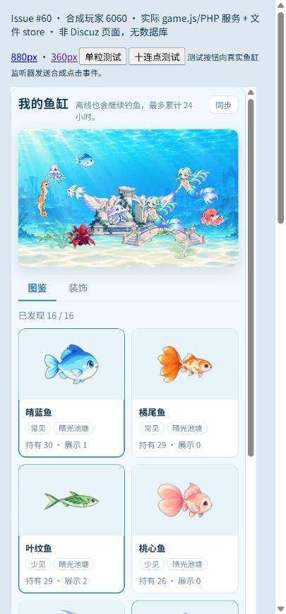
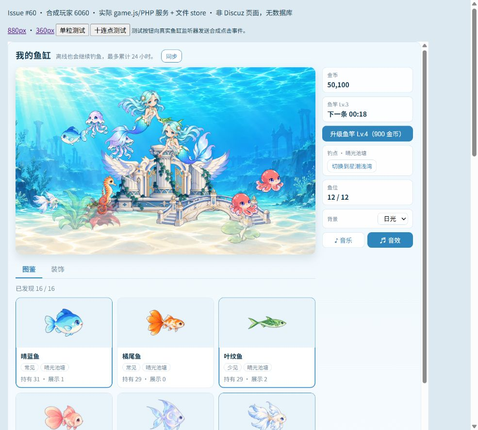

# 天使水族馆 1.2.0：接手后修复与本地回归

作者：GPT / Codex（小典）；原插件 (C) 2026 Carinoasd。2026-11-03（北京时间）。关联 [Issue #60](https://github.com/avgdaren/dz-gamecenter/issues/60)、[Draft PR #61](https://github.com/avgdaren/dz-gamecenter/pull/61)。

**首轮发现的校验、cutoff、小屏问题已修复；本轮执行的本地回归通过。** 本文是当前结果；[首轮接手记录](CODEX-HANDOFF-1.2.0.md)保留当时的失败与配置来源，不能把其中的失败数量当作修复后结果。

用户本轮明确取消真实场景验收要求。验证使用本机 PHP、原版 X5 数据库驱动及独立测试库、独立浏览器夹具；没有声称正式论坛或本地 Discuz 登录全流程已经通过。

## 修复内容

- 新增 `aquarium_state`，让服务所有请求、迁移分类和 verify 使用相同行头、规则、库存与布局校验。异常 schema、库存不守恒、展示超持有、限量鱼超过 3 条、行头/JSON 不一致、坏摘要等会被拒绝，原行不写入。
- 在线兼容入口允许完整旧库存补字段、缺标记补标记，以及尚无任何商店字段的历史档建立默认布局；已有坏布局不再通过 defaults 清洗。CLI 切池和 verify 仍要求完整合法新库存。foundation 没有布局是合法结构，跨命名迁移后才建立目标布局，未降低内容版布局检查。
- 自动 v1→v2 升级后继续操作会保持数据库行头为 v2；数据库写异常交给外层事务回滚/重试，不再返回一个未提交的新版本快照。
- 池切换 `--apply` 必须显式提供固定正整数毫秒 cutoff，拒绝缺失、非法及未来值。通用迁移续跑不得更改 job 中的切点，未来源行锚点不会推高任务切点。
- 360px 列布局改为拉伸主列，鱼缸不再收缩到约 122px。新增“同步”按钮；写操作响应丢失后，先同步确认最新状态，再允许后续写操作。初始化后立即拉取图鉴，页面隐藏后的操作也不再发送。
- 更新旧测试的库存字段、普通用户准入、异步目录加载及独立资源包预期；翻牌旧测试仅更新已支持的 v2 协议对照，未修改翻牌运行代码。没有修改配置价格、概率、终身上限或现有资源哈希。

独立复审另外发现“verify 漏查摘要”和“自动迁移吞数据库异常”，已修复并加入回归用例。

## 本轮实际结果

| 检查 | 结果 | 范围 |
| --- | --- | --- |
| PHP / JS / JSON / Python 语法、git diff --check | PASS | 原受跟踪文件全量扫描；新增 state PHP 和 pool Python 另验 |
| handoff_validation.php | **359 PASS，0 FAIL** | 21+ 类异常、全部 11 个服务动作、合法旧档/缺标记/已售库存/限量 3 条、升级连续请求、摘要、事务故障模型；非真实死锁压力 |
| rules / content | **345 / 62 PASS** | 规则边界与内容候选 |
| stock / sell / shop / stats / cap / migrate | **28 / 22 / 27 / 17 / 17 / 10 PASS** | 专项规则；closepack 默认 2、硬关闭+all 8 PASS |
| 独立 Python 参考 | **3625 / 7242 PASS** | 实际 PHP 对照，分别 3600 / 7200 次捕获 |
| service / entry / integration / front | **86 / 18 / 85 / 17 PASS** | 服务并发模型、路由模型、异步 DOM 模型；不冒充论坛 HTTP |
| X5 PDO、mysqli：foundation | **各 59 PASS** | 真实 MariaDB/InnoDB、querysafe、并发结算/购买、锁等待恢复 |
| X5 PDO、mysqli：v2 | **各 126 PASS** | 同上，并增加坏档各操作拒绝和原行字节不变对照；不改 ACTIVE_CONFIG |
| foundation→v1 迁移 CLI | **两驱动各 41 PASS** | 合成档 dry-run、apply、幂等、未知行隔离、备份恢复、中断续跑、拒绝改变切点 |
| v1→v2 池切换 CLI | **两驱动各 45 PASS** | 非空合成档、非法/未来 cutoff 拒绝、源配置结算到固定 N、重复不写、坏目标及未来源行停止 |
| 原资源 / 分包资源检查 | **751 / 450 PASS** | 所有 WebP 归属明确清单或兼容别名；图像解码、字节和哈希 |
| 旧游戏冒烟 | **25 / 扫雷 20 / 翻牌 74 PASS** | 五子棋缺少 room 适配仍是既有发现，不是此次水族馆改动 |
| 浏览器 360 / 880 iframe | **通过本轮检查** | 小屏缸宽约 323.33px、高 202.08px；桌面缸宽约 627.33px、高 392.08px；无脚本异常、16 图鉴/12 鱼、新鱼 4/4/4/8 帧 |

数据库为上一轮专门创建的 `codex_aquarium60_22a1b208_gc_test`，仅操作其中 `gct_` 合成测试表。mysqli 的 BIGINT 行字段返回字符串，测试比较按整数规范化；没有改变存档 JSON 的严格整数要求。普通无 DB 环境的套件会 SKIP 数据库测试；上表数据库结果来自单独启用环境的真实执行。

浏览器复验：360px 单粒新增 1、消费 1、成功播放一次最终 bite；十连点立即最多 8 粒，累计 9 粒全部消费，投喂没有增加写操作请求（正常 sync 轮询单列）。880px 手动点击“同步”成功。截图中的 uid 6060 全是合成测试数据。





## 复现

独立目录仍为 `E:\GPT工作区\dz-gamecenter-handoff`，分支仍为 `codex/issue-60-aquarium-handoff`，PR 目标仍为 `feat/aquarium-release-1`。

```powershell
$env:PHP_BIN = 'E:\dzx5-env\php\php.exe'
$env:PYTHONUTF8 = '1'
& $env:PHP_BIN tests/aquarium/handoff_validation.php
foreach ($suite in @('stock','sell','shop','stats','cap','migrate','rules','content_test')) {
    & $env:PHP_BIN "tests/aquarium/$suite.php"
}
foreach ($suite in @('reference_check','content_reference_check','service_test','entry_test','integration_140_test')) {
    python "tests/aquarium/$suite.py"
}
node tests/aquarium/front_test.mjs
& 'E:\tool\FormatFactory\FFModules\python\python.exe' tests/aquarium/assets_check.py
& 'E:\tool\FormatFactory\FFModules\python\python.exe' tests/aquarium/release_assets_check.py
```

真实库测试须提前建立独立空 `*_gc_test` 库，仅在进程环境提供 GC_TEST_DSN / GC_TEST_USER / GC_TEST_PASSWORD，并设置 GC_AQUARIUM_TEST=1、GC_DZ_ROOT 为原版 X5 根目录。以下脚本会重建该测试库内的 gct_ 表，不可指向论坛库：

```powershell
foreach ($driver in @('pdo','mysqli')) {
    $env:GC_TEST_DRIVER = $driver
    foreach ($config in @('aquarium-foundation-v1','aquarium-content-v2-candidate-v1')) {
        $env:GC_TEST_CONFIG = $config
        python tests/aquarium/db_test.py
    }
    Remove-Item Env:GC_TEST_CONFIG
    python tests/aquarium/migrate_test.py
    python tests/aquarium/pool_switch_test.py
}
```

## 未执行与边界

- 按用户本轮范围，不进行真实论坛权限/登录/玩家场景验收；真机、主观音频、长期压力、生产部署 SHA、正式玩家迁移/恢复均未验证。本地完整 Discuz HTTP 联调也未执行，浏览器使用明确标注的独立夹具。
- 没有把修复复制到 `E:\dzx5-env\www`；已有论坛进程、配置及数据库未改。小蓝原仓库未修改。无数据库升级、无 npm/依赖安装、无 main 合并。
- 首轮记录的 14 个未部署背景扩展文件、用户入水声来源/许可缺失仍保留原状；已入库声音回退可用，未补造来源或发布缺凭证素材。
- v1/v2 冻结 JSON 的 SHA-256 未变。运行开关、日志、凭据和合成存档不入库。
- 下一版 2 生物＋4 建筑仍仅为评估数量，题材未定；漂流瓶继续暂缓。
