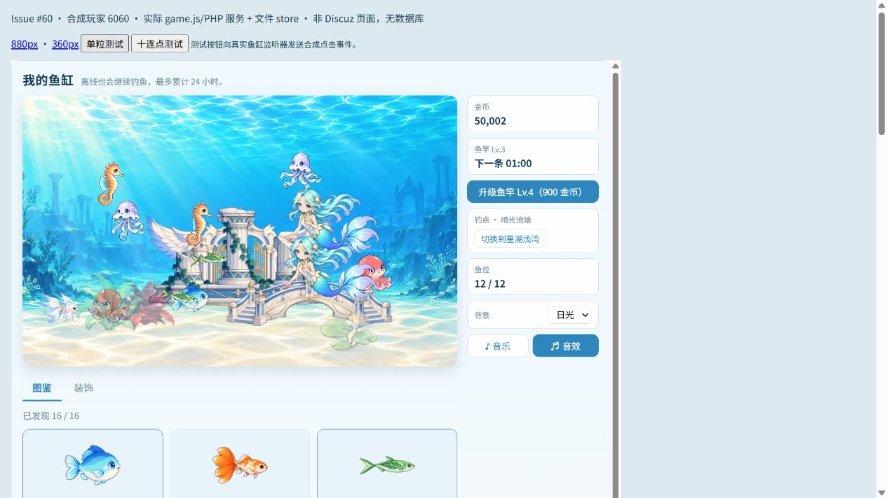
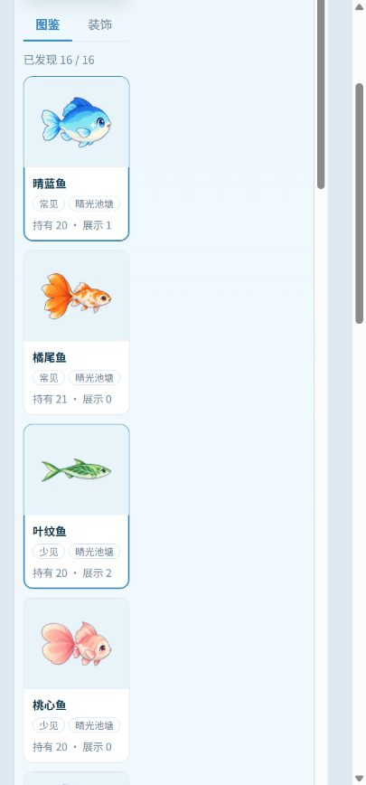

# 天使水族馆 1.2.0：Codex 首轮接手记录

> **2026-11-03 后续修复已完成本轮本地回归：** 严格校验 359 PASS；PDO/mysqli 的 v2 各 126、迁移各 41、池切换各 45 PASS；360px 布局已修。以[修复记录](CODEX-FIXES-1.2.0.md)为当前结果。下文首轮失败与更早记录仅保留历史。用户取消真实场景验收；未部署论坛、未改正式玩家数据、未合 main。

作者：GPT / Codex；原插件 (C) 2026 Carinoasd。2026-11-03（北京时间）。关联 [Issue #60](https://github.com/avgdaren/dz-gamecenter/issues/60)。仅私有项目协作使用。

**首轮接手检查已执行，静态配置缺口已补齐；当前基线未达到完整验收通过。** 本文区分源码核对、规则/服务模型、真实隔离库与浏览器夹具。旧版本台账不能替代本轮结果。

## 1. 目录、分支与边界

| 项目 | 本次核对结果 |
| --- | --- |
| 私有仓库 | `avgdaren/dz-gamecenter` |
| 候选基线 | `feat/aquarium-release-1@2a974d585e70cfcb1e1f1e51d19fb8029245f44e`；通过既有代理读取远端 refs |
| 远端 main | `76d226d12fed938d5592b60877d2fb9aadf8cdbd`，未作为本轮开发基线 |
| 水族馆版本 | 源码及本地部署 `games/aquarium/game.json` 均为 **1.2.0**；保留 standalone/wide 声明 |
| 独立分支 | `codex/issue-60-aquarium-handoff`，PR 目标为 `feat/aquarium-release-1` |
| 用户确认的独立 clone | `E:\GPT工作区\dz-gamecenter-handoff` |
| 小蓝原仓库 | `E:\工作区\人格会话\小蓝\天使动漫游戏中心项目\dz-gamecenter`；开始时无暂存/未提交/未跟踪变更；Git worktree list 仅该主检出 |
| 既有部署 | `E:\dzx5-env\www\source\plugin\gamecenter`，本次只读核对 |

已读根 `AGENTS.md`、#60、#53/#54/#58 及其回执、PR #55/#57/#59。三条美术 PR 仍 open/Draft，但相关运行资源已被集成，不补合并、不覆盖旧候选配置。GitHub 连接账号为 avgdaren；本机 Git 通过既有凭据成功 clone/fetch/push，独立 clone 的提交身份复用原仓库 avgdaren 的 noreply 身份，不修改全局配置。

本轮没有修改游戏规则、价格、权重或服务器校验实现，没有安装 npm 依赖。没有修改 Discuz 核心、论坛部署、正式玩家数据或 main，没有执行论坛部署/合并，没有插件数据库升级。新增了单独的测试数据库，见下文。

## 2. 源码与部署的差异

按候选基线的 **331 个受跟踪插件文件**逐文件读取并比较：

- 原仓库文件全部存在；33 处原始字节差异均仅为 CRLF/LF 换行，归一化后内容一致。其余 298 个字节一致。
- 部署目录中 284 个字节一致，33 个仅换行不同，14 个不存在：背景扩展 `background/expansion-v1/` 的 12 张 WebP + `catalog.json`，以及 `lib/aquarium_scenery.php`。
- 当前购买模块只登记日光/月光两种背景，搜索未发现运行入口引用 scenery 模块；上述 14 项属于已入库但本地未部署的背景扩展，不能当作已启用功能，也未自动补部署。
- `game.js`、`gamecenter.inc.php`、`lib/aquarium.php` 与本地部署字节一致。部署目录没有可独立证明整包提交 SHA 的 Git 标记，因此不把版本号/局部文件相同推断为正式论坛部署 SHA 已确认。
- 部署额外存在 `assets/audio/user/QA.json` 与 `sfx_splash_user.mp3/.ogg`。当前代码优先请求此入水声，失败后回退到已入库的 `audio/v2/sfx_splash`。QA 记录缺少准确来源页、作者和许可标识，状态为 unverified；本轮不将它们写成来源已确认、不补造授权、不入库。独立 clone 与原部署在该声音上存在明确差异；浏览器已观察到缺件拒播后回退成功。

对 PR 来源另核对 14 个运行 blob：#57 的 8 个 sprite/icon 兼容入口、#59 的 4 张动画图集、#55 的 2 个最终吃食音频，均与对应源提交逐字节一致。没有用美术 manifest 的历史经济候选覆盖当前配置。

## 3. v2 配置恢复

准确来源：小蓝原仓库与本地部署中的同路径 `source/plugin/gamecenter/games/aquarium/data/content-v2-candidate.json`，两处内容完全相同。

```text
bytes: 14793
SHA-256: c9423868b665127d6bc63da2373d442bd79d4f4e9dbe9b96157718725035040b
version: aquarium-content-v2-candidate-v1
```

原样复制，无格式化、重算/替换哈希或跳过校验。哈希与 `aquarium_content.php::V2_HASH` 完全一致。人工及加载器核对：只含静态配置/目录文案，16 种生物、24 件装饰（建筑 6 件）；两水域各 8 种；鱼位 4→8→12；四个新增 ID 均有终身上限 3 和对应鱼竿门槛，旧 ID/index 保留。`status` 和 `pricing_note` 是原文件中的历史标记，不据此宣称新经济参数已获批准。

干净 clone 在恢复前运行 `cap.php` 报 `DomainException: content-v2`；恢复后同一脚本 17 项通过。根 `.gitignore` 只对这个静态文件开例外，其他 aquarium/data 内容仍忽略；冻结 v1/v2 文件另声明 `-text` 保护哈希对应字节。暂存 blob 与强制 CRLF 环境下的 checkout-index 导出均须匹配原始 SHA-256。

部署的实际运行开关：`ACTIVE_CONFIG=aquarium-content-v2-candidate-v1`、sale-switch mode=off、无 SELL_HARD_OFF、无 MAINTENANCE。它们是本机只读观察，不代表生产论坛；**本轮不提交这些开关**。新 clone 缺 ACTIVE_CONFIG 时仍回退 foundation，需要测试时显式在独立副本配置，不误当作 v2 已自动激活。

## 4. 实际工具与环境

| 组件 | 本次读取/运行结果 |
| --- | --- |
| Discuz | `X5.0` + `.4.Open`，Release `20261010`，读取现有 source/discuz_version.php |
| PHP | `E:\dzx5-env\php\php.exe`，8.3.36 NTS x64 |
| MariaDB | 10.11.19-MariaDB；127.0.0.1:3306 现有进程 |
| nginx | 1.30.6；既有 :80 |
| php-cgi | 既有 5 个进程、:9000，与 1 父 + 4 子的拓扑一致；本轮未重启或重新配置 |
| Node | 24.19.0 |
| Python | PATH 中为 3.12.10；该解释器无 Pillow |
| 现有图像检查工具 | `E:\tool\FormatFactory\FFModules\python\python.exe`，3.7.4 / Pillow 7.0.0；未新增依赖 |
| 现有音频解码器 | `E:\tool\FormatFactory\ffmpeg.exe`，7.1 |

数据库只创建并使用新空库 **`codex_aquarium60_22a1b208_gc_test`**，`gct_` 为测试表前缀。复用原版 X5 的 PDO/mysqli 驱动文件，启用原有测试中的 querysafe。凭据仅从本机配置读入进程/子进程环境，不输出、不保存到文档或仓库。测试只造合成档；未查询/改写论坛玩家表。cutoff 探针另使用该隔离库中新建的空 `gcp_` 表。

## 5. 本轮 PASS / FAIL / 未验证

| 检查 | 本轮结果 | 证明范围/限制 |
| --- | --- | --- |
| 语法 | 初轮 PHP 67、JS 35、JSON 57、Python 25 均 PASS；新增检查文件另单独验语法 | 不等于行为正确 |
| stock / sell / shop / stats / cap / migrate | **PASS：28 / 22 / 27 / 17 / 17 / 10** | 规则/分类器；migrate.php 不覆盖 verify 或真实入口 |
| closepack | 默认分支 2 PASS；独立 clone 创建 SELL_HARD_OFF 且 sale-switch=all 后 **8 PASS** | 临时测试开关已还原，不触碰部署开关 |
| service_test.py | **PASS 86**，34 个并发请求 | 多 PHP 进程 + flock 服务模型，非 SQL 锁 |
| integration_140_test.py | **PASS 85** | 实际 PHP 路由 + DB 替身，非 HTTP/论坛 |
| legacy_rules_smoke.php / minesweeper | **25 / 20 PASS** | 旧游戏纯冒烟；gomoku room 适配缺口仍为历史发现 |
| db_test.py：PDO / mysqli | **各 59 PASS** | 实际 MariaDB/InnoDB、原版 X5 驱动、同窗口结算/购买竞争、重试；使用 foundation 默认配置，不代表 v2 论坛全流程 |
| release_assets_check.py | **PASS 450** | 原 79 张运行图、16 种动画、四新种静态图与别名、最终声音 manifest 的字节/哈希/图像解码；非全部美术主观验收 |
| 最终 MP3/OGG | **解码 PASS，无削波** | MP3 5072 samples≈115.011ms；OGG 4944 samples≈112.109ms；manifest 的母版内容时长仍为 115ms。编码解码长度差未改写为同值 |
| rules.php / content_test.php | **FAIL：stock-not-ready** | 手工构造档未满足现有库存前置条件；未改生产校验让旧测试通过 |
| reference_check.py / content_reference_check.py | **FAIL：fish 字典断言** | 旧独立参考没有 owned_count/sold_count；不能沿用历史 3600/7200 捕获 PASS |
| entry_test.py / front_test.mjs | **FAIL** | 旧路由用例期待非管理员被拒；旧 DOM 用例期待初始 sync，当前初始行为为依赖就绪后的 catalog；未把旧模型等同当前 UI |
| migrate_test.py（隔离库） | **FAIL：dry-run 12 行均 stock:anomaly:layout** | foundation 旧夹具缺少当前库存/布局前提，未达到整批迁移、恢复、幂等的验收后续 |
| 原 assets_check.py | **FAIL：no missing/unlisted runtime images** | 仍要求整个 assets 下只存在旧 79 图，新增独立资源包使末尾全目录断言过期；新增分包检查见上 |
| memory 原 check.mjs | **FAIL：actual 1 / expected 0** | 原有 v2 版本拒绝预期已过时，旧问题保留 |
| handoff_validation.php | **FAIL：36 检查中 23 失败** | 真实 PHP 服务/迁移器 + 合成内存 store；8 个正常同版本/正常 v1→v2 对照均 PASS；坏档负例见下一节 |
| pool-switch apply cutoff | **FAIL：缺失、nonsense、未来值都返回 0**；正常固定值对照也返回 0 | 在隔离库空表上执行真实 CLI，证明参数门禁未实现，不宣称已对账真实迁移数据 |

## 6. 当前真实阻塞

1. **统一严格校验仍未收口。** `verify()` 会把 schema99、库存不守恒、展示超库存、限量 catch=4 的目标行计入 target 且 broken 为空。目标 `classify()` 能拒绝前三类，却仍将限量 4 条判 skipped。
2. **同版本服务请求仍绕过校验。** 合成坏行分别通过实际 `request()` 的 init/catalog/sync/layout：schema99、展示超库存、限量 4 条、行头/JSON 配置版本不一致均存在未隔离路径，sync/layout 能调用保存。守恒错误在 init/catalog 漏报，sync/layout 被后续写前检查拒绝。这是控制器+替身证据，论坛 HTTP 仍未单独验收。
3. **固定 cutoff 非强制。** `tools/aquarium_pool_switch.php --apply` 接受缺失/非法 cutoff 并回退当前时间，也接受未来切点。下一步需明确合法整数、可信上界、重复任务固定 N，再验证拒绝与幂等，不能仅靠操作说明约束。
4. **360px 夹具存在布局失败。** iframe 实际 innerWidth=360，鱼缸主列/鱼缸宽约 **122px**、高 76.25px。当前 `.aq-body` 改为 column 后仍 align-items:flex-start，`.aq-main` 无宽度约束；这是夹具中的明确症状，需结合实际论坛样式修复/复验，不能写手机通过。

本 PR 保留这些失败并交接，没有顺手修改经济、校验或 CSS。下轮优先收口校验/切点/小屏，再重跑当前套件及真实论坛验收。

## 7. 浏览器实测的范围

新增 `tests/aquarium/browser_fixture.php`：必须 cli-server、`GC_AQUARIUM_FIXTURE=1`、回环地址；加载**当前原版 game.js/style.css/资源和实际 PHP 服务**，使用 uid=6060 的合成档及独立 clone 下 JSON 文件 store，不连接任何数据库。测试按钮向真实鱼缸监听器发送合成点击事件，不能冒充真实手机触控或 Discuz 登录流程。

- 880px 与 360px iframe 中均实际显示 16/16 图鉴、12 条新旧/重复混养；四新种 4/4/4/8 个帧切片均实际绘制，无 JS 异常。
- 两视口单粒测试：新增 1 粒、消费 1 粒，实际成功播放 1 次 `feeding/final-v1/bite_01.ogg`，loop=false、rate=1；没有因投喂调用保存接口。
- 两视口十连点测试：从空场立即只生成 8 粒；maxPellets=8。桌面完整观察 9 次消费（含先前单粒），咬合因节流会跳过，已播放间隔不低于 140ms，没有排队补播；不是要求每次密集消费都必须响。
- 部署未入库的入水声在独立 clone 中请求失败，既有 splash 回退实际播放成功；最终 bite 音不受影响。
- 保留人鱼不参与认领的当前实现；人鱼/水母周期仍为 game.js 的 2400/2600ms，人鱼宽度 0.26，其他三种 0.12，未按旧 runtime-map 回改。





**未验证：**真实论坛登录/注册/HTTP 全流程、真实手机、BGM 混音主观听感、MP3 格式回退、完整音频两声并发压力、减少动态/后台恢复、FPS/内存/长期压力、生产部署 SHA、真实玩家数据备份恢复/批量迁移及成对回滚。当前孤立浏览器和两驱动测试均不能代替这些项目。

## 8. 复现命令

在独立副本中执行；不得把下述测试指向正式论坛库，也不执行 ENVIRONMENT 旧文档里的部署示例。

```powershell
Set-Location 'E:\GPT工作区\dz-gamecenter-handoff'
$phpBin = 'E:\dzx5-env\php\php.exe'
$env:PHP_BIN = $phpBin
$env:PYTHONUTF8 = '1'
foreach ($suite in @('stock','sell','shop','stats','cap','migrate','closepack')) {
    & $phpBin "tests/aquarium/$suite.php"
}
& $phpBin tests/aquarium/handoff_validation.php # 当前应为 FAIL 36/23，不吞掉退出码
& 'E:\tool\FormatFactory\FFModules\python\python.exe' tests/aquarium/release_assets_check.py
python tests/aquarium/service_test.py
python tests/aquarium/integration_140_test.py
```

closepack 的硬关闭分支需要在**独立副本**创建 SELL_HARD_OFF，并将本地临时 sale-switch 设为 all，启动新 PHP 进程执行；之后还原本地临时文件。不要改部署目录。

真实库测试先建立专用空 `*_gc_test` 库，在进程环境提供 GC_TEST_USER/GC_TEST_PASSWORD（不写入命令历史/仓库），再设置：

```powershell
$env:GC_AQUARIUM_TEST = '1'
$env:GC_DZ_ROOT = 'E:\dzx5-env\www'
# GC_TEST_DSN 必须显式指向新隔离库；测试会 DROP/重建其中的 gct_ 测试表。
foreach ($driver in @('pdo','mysqli')) {
    $env:GC_TEST_DRIVER = $driver
    python tests/aquarium/db_test.py
}
python tests/aquarium/migrate_test.py # 当前 FAIL；不得因旧报告写成 PASS
```

浏览器夹具无需账号/数据库，不需要复制运行开关：

```powershell
$env:GC_AQUARIUM_FIXTURE = '1'
& $phpBin -S 127.0.0.1:18760 -t . tests/aquarium/browser_fixture.php
# 浏览器打开 http://127.0.0.1:18760/?width=880 或 ?width=360
```

所有本机 git 操作使用根 AGENTS 规定的两个 `-c http.proxy=http://127.0.0.1:7897 -c https.proxy=http://127.0.0.1:7897`。本轮原始输出只放忽略的 `tmp/issue60/`，不提交运行日志、开关、合成存档、凭据或数据库数据。

下一版仍仅按 **2 种新生物 + 4 件建筑**评估，数量/题材/价格/获取方式未定；漂流瓶暂缓。本轮没有把提案写成批准需求。
