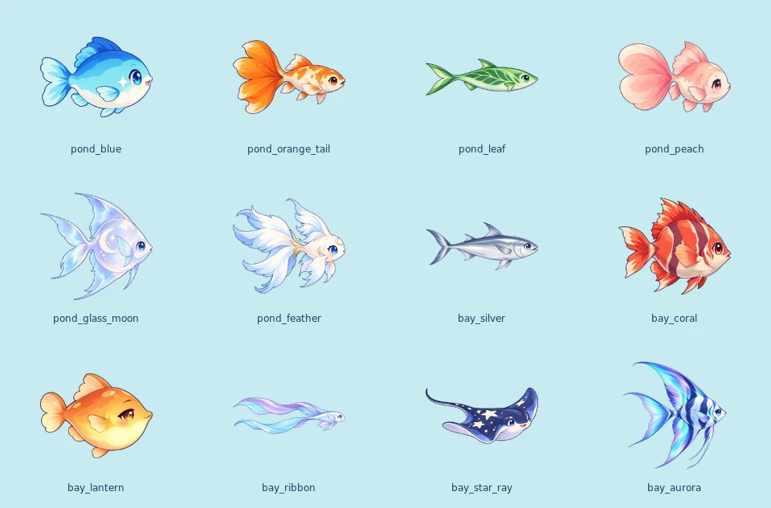
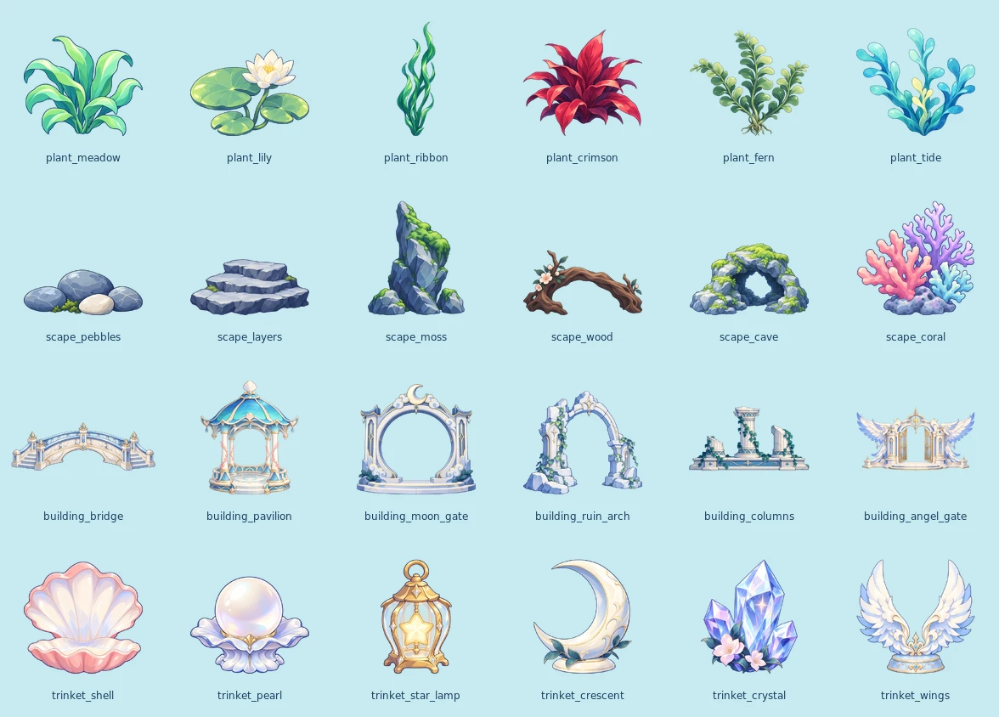
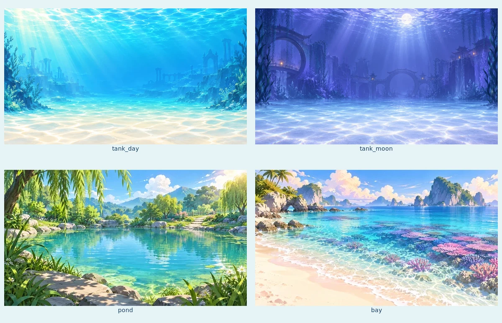
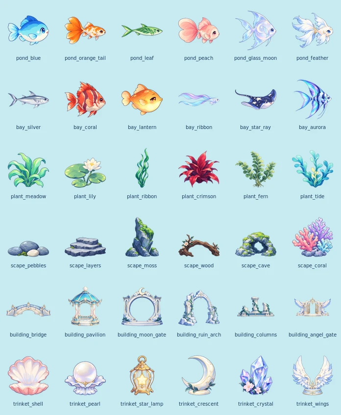

# 天使水族馆：内容美术资源包 v0.1

作者：GPT / Codex；原插件 (C) 2026 Carinoasd。2026-10-29（北京时间）。Refs #35 / PR #37。

范围：12鱼+24装饰+日光/月光2背景，另2钓点缩略图+1鱼竿图标，共**41项主图**；包含背景手机版本和36张缩略图，共**79张运行WebP**。已认可7样稿保留原始PNG，新生成34项母版也独立保留。批量新图为完整制作候选，不伪称用户已逐张认可。

用户分工：**GPT完成内容美术，小蓝负责具体UI、存档配置过渡、实际购买、布置及玩家界面**。实现总交接见[Issue #36](https://github.com/avgdaren/dz-gamecenter/issues/36)，资源接法见[接入说明](INTEGRATION-FOR-XIAOLAN.md)。不由本美术PR继续接玩家界面。

## 文件入口

- 运行根目录：`source/plugin/gamecenter/games/aquarium/assets/`。
- [权威资源manifest](../../../source/plugin/gamecenter/games/aquarium/assets/manifest.json)：逐项ID/中文名/种类/路径/尺寸/alpha/锚点/字节/SHA256/Git blob；不按目录遍历推断顺序。
- `fish/`12图、`decor/`24图；对应`thumbs/fish/`12图、`thumbs/decor/`24图。
- `background/`日光/月光各桌面与手机版；`water/pond.webp`、`water/bay.webp`为钓点，不是第三/四鱼缸背景。
- `icons/rod.webp`为鱼竿图标；其余具体UI图标/按钮/排版交小蓝设计，未打包成伪玩家界面。
- 母版：已认可7图在`samples/`，其余34图在`masters/`；对应来源、哈希见manifest与generation-progress.json。
- 完整新图提示词：[PROMPTS-BATCH-v0.1.json](PROMPTS-BATCH-v0.1.json)；此前样稿提示词保留v0.1/v0.2文档。使用内置imagegen，每项独立生成。
- [已认可ACG概念参考](reference/approved-acg-concept.png)，供小蓝处理具体UI时对照整体气质。

## 总览









## 导出约定

| 类型 | 主图 | 缩略图 / 变体 | 锚点 |
|---|---|---|---|
| 鱼 | 512×512 RGBA WebP，朝右；鳐略俯视 | 128×128透明 | (0.5,0.5) |
| 普通装饰 | 512×512 RGBA WebP | 128×128透明 | (0.5,0.9) |
| 小桥/列柱/天使庭门 | 1024×512 RGBA WebP | 128×128透明contain | (0.5,0.9) |
| 背景 | 1600×900不透明WebP | 手机960×720 | 全幅 |
| 钓点 | 480×270不透明WebP | 共用缩略图 | 全幅 |
| 鱼竿 | 256×256 RGBA WebP | 界面按需缩放 | (0.5,0.5) |

运行导出是机械裁透明边、等比缩放、留白归一和编码，不重绘母版。alpha>=16仅用于可见边界定位，边界内alpha保留；鱼/装饰至少保留外框空白，装饰接地线统一约90%。PNG原图与用户认可内容不被覆盖。ImageMagick做几何整理，经PNG中间文件由Pillow编码WebP并原子替换；sprite主图质量92、背景88、缩略图无损。避开本环境ImageMagick直接写WebP的异常。

资源尺寸是像素画布，不是场景中的统一显示大小。建筑应是主景，提灯是小点缀；不能因为同为512图，就把提灯和月门摆成一样大。前后层、密度和响应式由小蓝在真实UI中验证；装饰6/8/10位仍未定。

## 验证与边界

`python3 tests/aquarium/assets_check.py`检查41项/79图、候选ID与显式顺序、文件类型/尺寸、真实透明/非裁切边框、月门洞口、逐文件SHA256/Git blob、已认可母版不变。总览与96px检查板由实际运行图生成，已作人工轮廓/朝向/分层可读性检查。

未做：正式玩家UI合成、移动端实际渲染/解码内存/性能、购买拥有/存档配置过渡、游戏内前后遮挡/所有组合。图鉴/商店不应一次解码全部母版或全量资源；只加载当前场景和可见缩略图。不要把资源文件检查当成实站验收。

离线复导需要Python+Pillow及ImageMagick convert/montage，只是制作依赖，**服务器无这些依赖也可直接用随包WebP**：

```sh
python3 tools/export_aquarium_assets.py
python3 tests/aquarium/assets_check.py
```

本PR只增加美术/制作工具/文档；不改候选价格/规则/配置hash、不改旧插件逻辑或数据库、保持1.4.0，未合main或部署。
