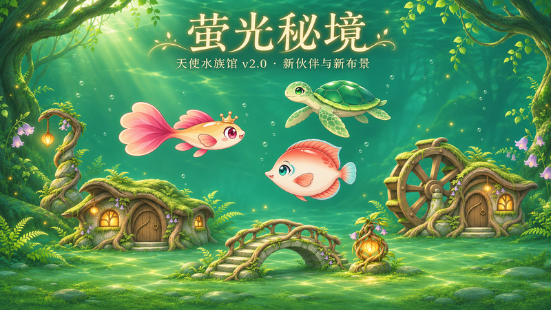

# 天使水族馆 v2.0 更新｜萤光秘境，新伙伴来访

林泉里亮起萤籽灯，新的伙伴游进鱼缸。

这次 v2.0 更新带来「萤光秘境」背景、14 件新布景与 3 种新生物，也加入背景商店、主题补齐和售鱼入口。给熟悉的鱼缸换一处风景，再慢慢收集新伙伴。

## 一套萤光秘境，自由搭出四种小景

萤根小筑、苔轮水坊、苔石拱桥、古根门庭和萤籽引路柱，配上花草、石径、叠石与灯火，共有 **14 件新布景**可供选择。每件独立拥有，可以和原有装饰自由混搭。

四组免费预设也一起加入：**林泉小居、苔轮溪桥、林间歇脚、萤石静庭**。预设是推荐摆法，使用已拥有的素材；缺少的背景或装饰会有提示，不会自动替你购买。

新布景合计 **90,000 金币**，萤光秘境背景 **10,000 金币**，全套标价合计 **100,000 金币**。可以单件慢慢买，也可以用主题包一键补齐缺件；已拥有的不会重复收费，没有额外套装折扣。

## 三种新伙伴，等你升到最高档鱼竿

| 新伙伴 | 品级 | 出没水域 |
| --- | --- | --- |
| 青芽海龟 | 珍奇 | 星潮浅湾 |
| 绮霞古比 | 稀有 | 晴光池塘 |
| 珊澜蝶鱼 | 珍奇 | 星潮浅湾 |

三种新生物都需要 **鱼竿 Lv.5**，每个账号、每个鱼种**终身最多捕获 6 条**。达到门槛后，到对应钓点等待相遇；收满后，该鱼种就不会继续被钓到。

## 新增 Lv.5 鱼竿，留下一个更长的目标

从 Lv.4 升到 Lv.5 需要 **20,000 金币**，升级后钓鱼周期缩短为 **60 秒一条**，同时开放三种新生物。升级由你手动选择，不会自动扣金币。

## 七景背景商店，买一次，之后免费切换

日光、月光继续初始拥有；樱溪浅梦、珊瑚晴湾、星眠遗庭、极光冰湖和萤光秘境，可以在「背景」页查看与购买。

每个背景都能先看大图、价格和解锁条件。**购买后永久拥有，切换免费**；购买不会自动替换当前背景。换背景时，鱼、装饰和钓点继续保留，也不会改变钓鱼收益。

## 多余的鱼，可以换成新的布景

图鉴中可以按鱼种选择出售数量，确认收益后换取金币。可售鱼**每种至少保留 4 条**；如果缸里展示的更多，就按展示数量保留，正在展示的鱼不会被卖掉。

本次新增的海龟、古比和蝶鱼也允许按上述规则出售；原有的卷尾海马、铃伞水母、软糖章鱼和月汐人鱼继续不可售。**出售不会清除图鉴记录，也不会回退终身捕获数**，卖掉后不会重新补出捕获名额。

## 原有收集与进度继续保留

原有金币、鱼竿、水域、图鉴、库存与已购装饰会随存档保留。更新不会自动购买新商品、出售库存或替换你当前的布景。

打开水族馆，先去「背景」看看萤光秘境，再给新伙伴留几个鱼位吧。
