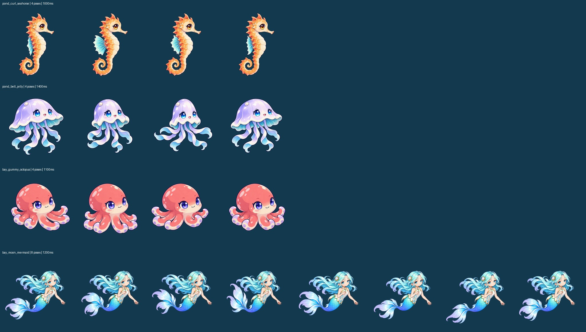
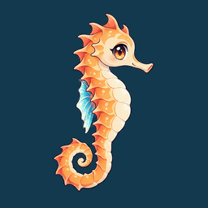
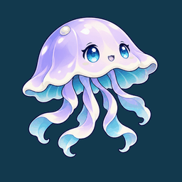
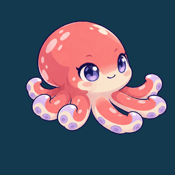
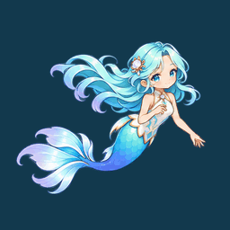

# 四种新鱼 · 游动美术第一版

作者：GPT / Codex。原插件 (C) 2026 Carinoasd。仅本私有项目使用。

承接 #58，源需求为 [#53 comment 6559478349](https://github.com/avgdaren/dz-gamecenter/issues/53#issuecomment-6559478349)。基线 `feat/aquarium-release-1@944c17f00562737e73618cd750a02bca5fc76f13`。这是待集成实测的美术候选，不代表实机验收通过。

## 交付内容

| 生物 / ID | 动作 | 帧数 / 周期 | 横向图集 |
| --- | --- | --- | --- |
| 卷尾海马 `pond_curl_seahorse` | 背鳍展开、收拢，身体保持直立 | 4 / 1000ms | 1024×256 |
| 铃伞水母 `pond_bell_jelly` | 伞盖收缩再舒张，触手跟随弯曲 | 4 / 1400ms | 1024×256 |
| 软糖章鱼 `bay_gummy_octopus` | 两侧腕足交替卷曲、伸展 | 4 / 1100ms | 1024×256 |
| 月汐人鱼 `bay_moon_mermaid` | 尾部、扇形尾鳍上下摆动，头部对齐 | 8 / 1200ms | 2048×256 |

每帧256×256、透明WebP，`grid:[N,1]`，右朝向。四张运行图共812,432字节（约793KiB），解码RGBA新增5MiB，同一物种多实例可共用图集。运行文件在 `source/plugin/gamecenter/games/aquarium/assets/fish-motion/v1/`。

这些是内置 `image_gen` 按批准静态角色生成的不同姿态，再等比缩放、按头部/身体锚点排帧。没有把原静图做逆向形变，没有用CSS摆动充当序列帧；也不是人工逐帧手绘。图像生成仍可能有细微线条/五官差异，需按实际播放判断是否接受。`*-poses.webp` 为透明姿态母版，`prompts.json` 保存采用的生成提示词，`packing.json` 记录裁切和锚点。导出只处理排版与尺寸，不绘制新动作。

## 给小蓝的接入步骤

1. 获取本PR的4张运行图和 `manifest.json`。已经追加4个条目，原12个条目逐项保持一致；`new-entries.json` 同时提供独立追加项。若本地manifest有其他新增项，请只按ID合并这4项，不覆盖本地其他改动。
2. 基线代码的 `MOTION` 在 `game.js` 内，由 `assets/fish-motion/v1/manifest.json` 的 `items` 加载。`fish-sprites.js` 是通用播放器，本次无需在里面再写一份MOTION表；已有mount会读取 `frame_size[0] / grid[0] / frame_count / cycle_ms`。
3. 继续用现有单canvas播放器整帧清空后绘制。勿再叠一层旧静图、独立尾鳍或CSS `AQ_SWIM` 补偿。基线远端未发现 `AQ_SWIM`，但小蓝本地测试分支如有补偿需撤掉。外层游动路径、转向、入水和轻微位移继续由现有逻辑处理。
4. 人鱼显示宽度建议先试0.26，0.24–0.28供实景微调；这不是已测定的最终值。本版透明内容大约占帧宽的0.8，按0.26外框估算，880px缸宽可见形象约183px、360px约75px。注意基线 `createFish` 还有160px的 `maxWidth`，若实际尺寸被卡住，需要一并检查该上限。本PR不改布局代码。
5. 人鱼吃不到食物的追踪范围修复继续由小蓝负责，本次不把进食问题混入美术。已知小蓝本地追逐边界改为0.06–0.94，请合并时保留。
6. 运行图和manifest如有缓存，请使用项目现有资源版本机制刷新，避免新图集搭配旧帧数。

## 查看与复导出

- `preview.html` 使用仓库原版 `fish-sprites.js` 播放，含四种单体与12实例素材展示，可离线打开；不是鱼缸行为模拟。
- 下列GIF是烘焙预览，时间以10ms取整，最终准确周期以manifest和HTML播放器为准。
- 复导出：在仓库中执行 `python docs/art/new-fish-motion-v1/export_motion.py`。离线美术处理机需Pillow、NumPy、SciPy，游戏运行时不引入这些依赖。源母版不改写，排帧参数在脚本中。`base-manifest.json` 是本次冻结的12鱼基线，复导出会据此重建本次候选manifest；如后续已有更多物种，请合并条目，勿直接覆盖。
- 合约检查：`node docs/art/new-fish-motion-v1/verify-player.cjs`。

| 海马 | 水母 |
| --- | --- |
|  |  |

| 章鱼 | 人鱼 |
| --- | --- |
|  |  |

## 已检查与待检查

已完成：图集实际解码、尺寸/透明通道、20帧均不同且四边留空、字节/SHA256/Git blob SHA、原12条目深比较一致、JSON与新增JS语法；逐帧总览人工查看。导出脚本从交付母版复跑后，4张运行图SHA256保持一致。

Node DOM/canvas模拟：4张图集的全部20个切片和循环归零、单canvas清空绘制、12实例共享4次加载、减少动态效果首帧及dispose清理通过。模拟不测GPU、实际下载/解码、帧率、画面观感或完整鱼缸。

未验证：Discuz/PHP运行环境、真实浏览器播放、360px手机与桌面鱼缸、12鱼混养及投喂追逐、缓存失效、真实FPS/内存。交由小蓝集成实测，尤其看4帧动作的节奏、人鱼脸部稳定性和0.26尺寸是否合适。若4帧跳变显眼，应补中间姿态，勿用叠图补帧。

本PR只交付美术、配置与预览文档，无数据库升级，不改经济、购买、数量规则或服务端接口。不合并、不部署。
